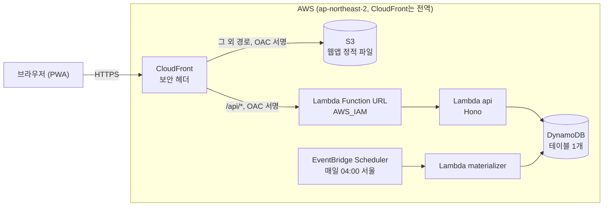

# 아키텍처

웹앱 정적 파일과 API를 CloudFront 도메인 하나로 내보낸다. 서버는 모두 요청이 올 때만 도는 관리형 서비스라서, 쓰지 않는 달의 고정 비용이 없다. Terraform 구성은 `infra/app`에 있다.

## 요청 흐름

API 요청 하나가 거치는 검사는 순서대로 다음과 같다.

1. **CloudFront**: HTTPS만 받는다. `/api/*`는 캐시하지 않고, `Host`를 뺀 헤더와 쿼리 문자열을 그대로 Lambda Function URL로 넘긴다. 이때 OAC가 요청에 SigV4 서명을 붙인다.
2. **Lambda Function URL**: 인증 방식이 `AWS_IAM`이라 서명이 없거나 틀린 요청은 함수를 실행하기 전에 403으로 거부한다. 서명할 권한은 이 CloudFront 배포 하나에만 있다.
3. **앱 토큰**: 함수 안에서 `X-App-Token` 헤더의 SHA-256을 저장된 해시와 상수 시간으로 비교한다. 헤더가 없으면 DB를 읽기 전에 401이다.
4. **입력 검사**: zod 스키마가 본문과 경로 값을 검사하고, 틀린 필드를 `details`에 담아 400으로 돌려준다.

이렇게 정한 이유는 [ADR 0002](decisions/0002-cloudfront-lambda-function-url-oac.md)에 있다.

## 리소스

| 리소스 | 하는 일 | 설정 |
| --- | --- | --- |
| CloudFront | 웹앱과 API를 한 도메인으로 내보낸다 | `PriceClass_200`(한국 엣지 포함), HTTP/2·3, 기본 인증서 |
| CloudFront 함수 | 확장자 없는 웹앱 경로를 `/index.html`로 바꾼다 | S3 쪽 동작에만 붙는다. `/api/*`에는 붙지 않는다 |
| S3 웹 버킷 | 웹앱 정적 파일 | 공개 접근 차단, 이 배포만 읽기 허용 |
| Lambda `api` | API | Node.js 24, arm64, 512MB |
| Lambda `materializer` | 반복 규칙의 근무를 90일 앞까지 채운다 | Node.js 24, arm64, 256MB |
| DynamoDB | 모든 데이터 | 프로비저닝 읽기·쓰기 각 10, 시점 복구, 삭제 방지 |
| EventBridge Scheduler | materializer를 매일 부른다 | `cron(0 4 * * ? *)`, Asia/Seoul |
| CloudWatch Logs | Lambda 로그 | JSON 형식, 30일 보관 |

## 웹앱 경로와 캐시

웹앱은 History API로 화면을 바꿔서, 주소가 `/payroll`처럼 파일이 아닌 경로가 된다. S3에는 그런 파일이 없으므로 CloudFront 함수가 요청이 S3에 닿기 전에 경로를 `/index.html`로 바꾼다.

- S3 403을 `index.html`로 바꾸는 사용자 지정 오류 응답은 쓰지 않는다. 배포 전체에 걸려서 API의 403·404 응답까지 웹앱 HTML로 바뀐다.
- 파일 이름에 해시가 붙은 `assets/`는 1년 동안 캐시하고, `index.html`과 서비스 워커처럼 이름이 고정된 파일은 `no-cache`로 올린다. 올리는 방법은 [배포 문서](deploy.md#5-웹앱-올리기)에 있다.
- 서비스 워커는 앱 화면만 미리 받아 두고 `/api/*` 요청은 가로채지 않는다([ADR 0003](decisions/0003-pwa-and-ics-instead-of-native-app.md)).

## 응답 헤더

CloudFront 응답 헤더 정책이 웹앱과 API 응답에 모두 붙인다.

| 헤더 | 값 | 이유 |
| --- | --- | --- |
| `Content-Security-Policy` | `default-src 'self'; img-src 'self' data:; object-src 'none'; base-uri 'self'; form-action 'self'; frame-ancestors 'none'` | 외부 스크립트, 폰트, 분석 도구를 넣지 않는다는 규칙을 브라우저가 강제한다 |
| `Strict-Transport-Security` | `max-age=31536000` | 한 번 접속한 브라우저는 1년 동안 HTTP로 접속하지 않는다 |
| `X-Frame-Options` | `DENY` | 다른 사이트가 이 앱을 iframe에 넣지 못한다 |
| `X-Content-Type-Options` | `nosniff` | 브라우저가 응답 형식을 추측하지 않는다 |
| `Referrer-Policy` | `no-referrer` | 다른 사이트로 이동할 때 주소를 넘기지 않는다 |
| `Permissions-Policy` | `camera=(), microphone=(), geolocation=(), payment=()` | 쓰지 않는 브라우저 기능을 끈다 |

## 비용

사용자 한 명의 사용량은 모두 상시 무료 한도 안에 든다. Lambda는 월 100만 건, CloudFront는 월 1TB와 1,000만 건, DynamoDB는 프로비저닝 용량 각 25까지다. 무료 한도가 없는 것은 S3 저장 요금과 DynamoDB 시점 복구 요금인데, 둘 다 데이터가 수 MB라 월 몇 원 수준이다. 요금이 나오기 시작하면 월 예산 알림이 메일을 보낸다([배포 문서](deploy.md#예산-알림)).

## 하지 않은 것

- 사용자 도메인: CloudFront 기본 도메인(`*.cloudfront.net`)을 쓴다. 도메인을 붙이려면 Route 53과 us-east-1의 ACM 인증서가 필요하다.
- 요청 제한(WAF): 고정 요금이 든다. 이유와 다시 검토할 조건은 ADR 0002에 있다.
- 접속 로그: CloudFront 표준 로그는 S3 저장 요금이 들고, 한 사람이 쓰는 앱에서 볼 일이 적다.
