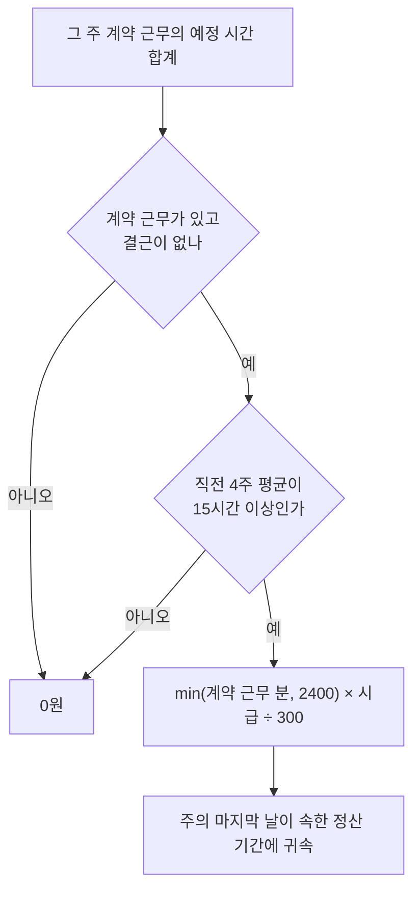

# 급여 계산 규칙

급여는 **기본급 + 주휴수당 − 공제**로 계산한다. 금액은 원 단위 정수, 시간은 분 단위 정수, 요율은 백만분율 정수로만 다루고, 나눗셈은 마지막에 한 번만 해서 원 미만을 버린다. 구현은 `packages/shared`에 있고, 이 문서의 테스트 케이스가 그대로 단위 테스트로 들어 있다.

상시 5인 미만 사업장을 전제로 한다. 야간·연장·휴일 가산수당(통상임금의 50%)은 5인 이상 사업장에만 적용되므로 계산하지 않는다.

## 날짜와 시각

- 모든 날짜와 시각은 서울 시각(UTC+9)으로 해석한다. 한국에는 서머타임이 없어서 고정 오프셋으로 계산해도 오차가 없다.
- 시각은 오프셋 없는 문자열(`2026-11-03T22:00`)로 저장한다.
- 서버의 "오늘"은 `todayInSeoul()` 하나로만 구한다. Lambda는 UTC로 실행되므로, 그냥 현재 날짜를 구하면 서울 시각 00:00~08:59 사이에 하루 전 날짜가 나온다.
- 밤샘 근무는 시작한 날짜(`workDate`)에 속한다. 정산 기간과 주휴 주차도 이 날짜로 나눈다.

## 정산 기간

정산 시작일을 S(1~28)라고 하면, 기간은 매월 S일부터 다음 달 S−1일까지다. S가 1이면 그 달 1일부터 말일까지다. 29~31일은 2월에 없어서 허용하지 않는다.

## 근무 한 건의 시간

| 상태 | 뜻 | 급여 시간 | 소정근로 시간 | 개근 |
| --- | --- | --- | --- | --- |
| `SCHEDULED` | 예정 그대로 | 예정 시간 | 계약 근무면 예정 시간 | 영향 없음 |
| `WORKED` | 실제 시각을 입력함 | 실제 시간 | 계약 근무면 예정 시간 | 영향 없음 |
| `ABSENT` | 결근 | 0 | 계약 근무면 예정 시간 | 그 주 개근 실패 |
| `CANCELLED` | 합의로 빠진 날 | 0 | 0 | 영향 없음 |

- 급여 시간 = (종료 − 시작) − 무급 휴게. 세 값 각각 실제 값이 있으면 실제 값을, 없으면 예정 값을 쓴다.
- 소정근로 시간은 계약 근무(`REGULAR`)의 **예정** 시간만 센다. 대타·추가 근무(`EXTRA`)와 실제로 더 일한 시간은 주휴수당 판정에 들어가지 않는다.
- 지난 날짜의 `SCHEDULED` 근무는 예정대로 일한 것으로 본다.

## 기본급

```latex
\text{기본급} = \left\lfloor \frac{\sum_{\text{근무}} \text{급여 시간(분)} \times \text{그날 시급}}{60} \right\rfloor
```

- 시급은 근무 날짜에 적용되는 시급 이력 값(적용 시작일이 그 날짜 이하인 것 중 가장 최근)을 쓴다.
- 오늘 이전 근무는 확정분, 오늘 이후 근무는 예상분이다. 예상분은 전체에서 확정분을 빼서 구하므로, 두 금액의 합이 항상 전체와 같다.

## 주휴수당

주마다 아래 순서로 판정한다. 주는 설정한 요일(기본 월요일)부터 7일이다.



- **평균**: 그 주를 포함한 직전 4주의 계약 근무 시간을 평균낸다. 입사일보다 먼저 끝난 주는 빼고, 남은 주로만 평균낸다. 근로기준법 제18조 제3항은 "4주 동안을 평균하여 1주 소정근로시간이 15시간 미만"인 근로자를 적용 제외로 정할 뿐 어느 4주인지는 정하지 않아서, 이 구현은 이동 평균으로 해석했다. 설정에서 그 주만 보는 방식으로 바꿀 수 있다.
- **금액**: `min(계약 근무 분, 2400) ÷ 5`가 주휴로 인정되는 시간이다. 이는 "소정근로시간 ÷ 40 × 8시간"과 같고, 주 40시간 이상이면 8시간분에서 멈춘다. 시급은 그 주 마지막 날의 시급을 쓴다.
- **귀속**: 주의 마지막 날이 속한 정산 기간에 들어간다. 그래서 11월 정산에는 10월 26일~11월 1일 주가 들어가고, 11월 30일~12월 6일 주는 12월 정산에 들어간다.
- **확정 여부**: 주의 마지막 날이 지나기 전까지는 예상분이다.
- **참고 값**: 대타와 연장까지 포함한 실제 근무 시간의 4주 평균도 함께 계산한다. 계약은 15시간 미만인데 실제로는 계속 그보다 많이 일하는 경우를 알아볼 수 있게 하기 위해서다. 판정에는 쓰지 않는다.

## 공제

공제 기준 금액은 기본급 + 주휴수당이다. 공제 프로필도 적용 시작일별 이력이고, 정산 기간 마지막 날에 적용되는 프로필을 쓴다. 항목마다 10원 미만을 버린다.

| 프로필 | 항목 | 2026년 근로자 요율 | 계산 |
| --- | --- | --- | --- |
| 3.3% 원천징수 | 사업소득세 | 3% | 기준 × 요율 |
| 3.3% 원천징수 | 지방소득세 | 사업소득세의 10% | 사업소득세 × 요율 |
| 4대보험 | 국민연금 | 4.75% | 기준 × 요율 |
| 4대보험 | 건강보험 | 3.595% | 기준 × 요율 |
| 4대보험 | 장기요양보험 | 건강보험료의 13.14% | 건강보험료 × 요율 |
| 4대보험 | 고용보험 | 0.9% | 기준 × 요율 |
| 4대보험 | 근로소득세 | 간이세액표 | 직접 입력 |
| 4대보험 | 지방소득세 | 근로소득세의 10% | 근로소득세 × 요율 |

- 4대보험은 항목마다 켜고 끌 수 있다. 단시간 근로자는 항목마다 가입 기준이 달라서 일부만 내는 경우가 흔하기 때문이다.
- 실제 회사는 신고된 보수월액을 기준으로 보험료를 떼므로, 앱의 4대보험 금액은 추정치다.
- 국민연금 요율은 2033년까지 매년 오르므로 매년 새 요율 이력을 추가해야 한다.

## 경고

계산은 되지만 값이 틀렸을 수 있으면 결과의 `warnings`에 넣는다.

- 정산 기간이 끝나는 해의 시급 이력이 없어서 이전 해 시급으로 계산했을 때. 최저임금은 매년 1월 1일에 바뀐다.
- 4대보험 프로필인데 그해 요율 이력이 없을 때

## 테스트 케이스

시급 10,320원, 주는 월요일 시작, 4주 평균 방식이다. 모두 가상의 근무다.

| # | 상황 | 입력 | 기대 결과 |
| --- | --- | --- | --- |
| 1 | 주 15시간 경계 | 월·수·금 18:00~23:00 | 기본급 154,800원, 주휴 30,960원 |
| 2 | 주 15시간 미만 | 화·목 7시간, 4주 | 평균 14시간, 주휴 0원 |
| 3 | 주마다 다름 | 입사 첫 주부터 12, 18, 14, 20시간 | 주휴: 0원, 37,152원(평균 15시간), 0원(평균 14.67시간), 41,280원(평균 16시간) |
| 4 | 결근 | 1번에서 수요일 결근 | 기본급 103,200원, 주휴 0원 |
| 5 | 연장과 대타 | 1번 + 금요일 1시간 연장 + 토요일 대타 4시간 | 기본급 206,400원, 주휴 30,960원(소정근로는 그대로 15시간) |
| 6 | 40시간 상한 | 주 6일 × 7시간 = 42시간 | 주휴 82,560원(8시간분) |
| 7 | 밤샘 근무 | 일요일 22:00 ~ 월요일 02:00 | 240분, 일요일이 속한 정산 기간에 귀속 |
| 8 | 시급이 바뀌는 주 | 2026-12-28~2027-01-03 주 월·수·금 5시간, 2027-01-01부터 10,700원 | 기본급 12월 103,200원 + 1월 53,500원, 주휴 32,100원(주 마지막 날 시급)은 1월 정산 |
| 9 | 3.3% 공제 | 기준 185,760원 | 사업소득세 5,570원, 지방소득세 550원, 실지급 179,640원 |
| 10 | 4대보험 공제 | 기준 800,000원 | 국민연금 38,000원, 건강 28,760원, 장기요양 3,770원, 고용 7,200원, 합계 77,730원 |

한 달 전체를 합친 예시도 테스트한다. 월·수·금 18:00~23:00 계약에 하루 1시간 일찍 출근, 대타 1회(5시간), 오늘이 11월 18일인 11월 정산이다.

| 항목 | 금액 |
| --- | --- |
| 기본급 (확정 36시간 / 예상 35시간) | 371,520원 + 361,200원 = 732,720원 |
| 주휴수당 (5주, 그중 3주 확정) | 154,800원 |
| 세전 | 887,520원 |
| 3.3% 공제 | 29,280원 |
| 실지급 | 858,240원 |

## 하지 않는 것

- 야간·연장·휴일 가산수당, 휴업수당, 연차수당, 퇴직금
- 근로소득세 자동 계산 (간이세액표 금액을 직접 넣는다)
- 퇴사하는 주의 주휴수당 판정 (행정해석으로 판단하는 영역이라 직접 확인한다)
